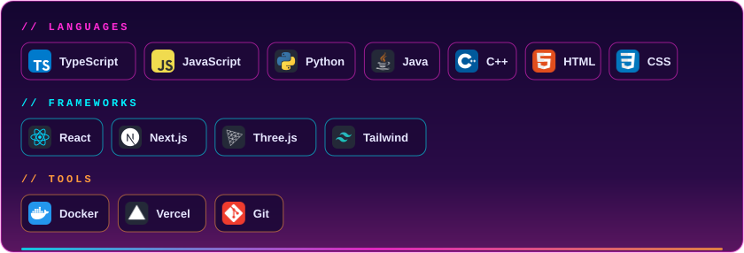

  

  

  
  

  

  

<!-- BUILDING:START -->

| project | description | lang | last push |
|:--|:--|:-:|:-:|
| [**study-arcade**](https://github.com/nik12mcf/study-arcade) | Recreate the old quizlet gravity game | `JavaScript` | 3 days ago |
| [**screen-upscaler**](https://github.com/nik12mcf/screen-upscaler) | macOS app: record a screen region and AI-upscale it to 1080p–4K at any FPS — Real-ESRGAN (Core ML, Neural Engine), Apple VideoToolbox super-resolution, or FlashVSR via fal.ai | `Swift` | 5 days ago |
| [**osrs-scripts**](https://github.com/nik12mcf/osrs-scripts) | Screen-reading Python scripts for Old School RuneScape: record an agility course once, then run laps automatically | `Python` | 5 days ago |
| [**personal-website**](https://github.com/nik12mcf/personal-website) | Personal Website to Display Resume and Personal Projects | `TypeScript` | 3 months ago |
| [**Mashey_Asteroid**](https://github.com/nik12mcf/Mashey_Asteroid) | Mashey's Technical Interview Repo. | `Python` | 4 years ago |
| [**Amazon_Scraper**](https://github.com/nik12mcf/Amazon_Scraper) | — | `Python` | 5 years ago |

<!-- BUILDING:END -->

  <picture>
    <source media="(prefers-color-scheme: dark)" srcset="https://raw.githubusercontent.com/nik12mcf/nik12mcf/output/snake-dark.svg" />
    <source media="(prefers-color-scheme: light)" srcset="https://raw.githubusercontent.com/nik12mcf/nik12mcf/output/snake-light.svg" />
    
  </picture>

